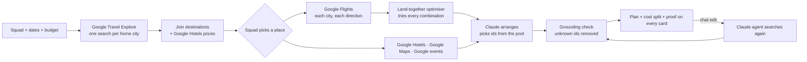

# Pakka

**The group trip that actually happens: Pakka finds where friends in different cities can afford to go, lines up flights so everyone lands together, and builds a plan where every flight, hotel, place and event is a real Google result.**

Built for the SerpApi India Hackathon 2026 · Travel & Local Discovery.

## The problem

Every friend group has a "Goa trip 🌴" WhatsApp group. It fills up with "chalo!" and then nothing happens, because four people in four cities can't line up flights, dates and money. Someone opens four airline tabs, someone else finds a hotel nobody can afford, and the trip quietly dies.

AI trip planners don't fix this. They plan for one traveller, and they make things up: restaurants that closed, hotels at prices from last year. Even polished ones go stale. Layla's public sample trip, for example, shows a flight price that has long since expired. A plan you can't trust is just another chat message.

## What Pakka does

1. **Squad Match: "Where should we go?"** Enter each friend's home city and a budget, and leave the destination empty. Pakka runs Google Travel Explore from every city, keeps the places everyone can fly to, prices real hotels there, and ranks them by what the whole squad pays and how fair the split is ("≈ ₹18,985 each · gap ₹4,197 · 3/4 within budget").
2. **Land together.** For the chosen place, Pakka searches Google Flights for every person, both ways, keeps every nonstop plus the cheapest options, and tries every combination. Each combination is scored on price plus penalties for arriving far apart, landing at a different airport from the others (Goa's GOI and GOX are 1.5–2 h apart), slow flights and stops. All of these are in one place: [lib/land-together.ts](lib/land-together.ts). The plan shows the result plainly ("Everyone lands between 18:25 and 21:15 at GOI"), or says who is split off.
3. **A grounded day-by-day plan.** Claude arranges hotels, places and events, but it can only pick from what search returned. Code checks every item against the search results and removes anything else. Claude is steered to a hotel near the plan and is asked to reconsider once if the hotel ends up more than 10 km from most stops. The plan also includes:
   - a map route for each day (click a day to focus it) and "≈ N km today" under each day;
   - a cost split with an over-budget callout ("Kabir is ₹1,649 over budget" with a one-tap "Find Kabir cheaper flights") and an equal-split view showing who pays whom;
   - a "Copy for WhatsApp" button.
4. **Chat edits that search again.** "Make it cheaper", "Kabir can't leave Delhi before 6pm Friday" or "Add a sunset cruise" trigger new Google searches, re-sync everyone's flights, and pass the same grounding check.

## Screenshots

> _Add screenshots before submitting:_
> - `docs/squad-match.png`: ranked destinations with lines from each friend's city
> - `docs/plan.png`: arrival timeline, flights, hotel, day timeline and map
> - `docs/chat.png`: a chat edit with search lines and the cost pill
> - `docs/receipts.png`: the search receipts drawer

## How it works



**Grounding, the core promise.** Every search result is normalised into a candidate with a stable id taken from Google's own data (`place:<place_id>`, `hotel:<property_token>`, …). Claude sees a compact numbered list (`p12 | Fort Aguada | Tourist attraction | 4.2★ (111,855) | …`) and must answer through a tool call that contains only ids. The server then:

- looks up every id and **removes anything that isn't in the search results**, then asks Claude once to fix just those days;
- builds every card from the search result itself. Names, prices, ratings, hours and photos never come from Claude;
- drops any sentence of Claude's own text that states a number or price, so its short notes can't pass as facts;
- shows "✓ N/N verified with live Google data", with how many suggestions were removed.

**Proof on every card.** Each flight, hotel, place and event shows where it came from and when ("Google Maps · checked 3 min ago ↗"), with a link to the source. The **search receipts** drawer lists every SerpApi call behind the plan, with its engine, query, live/cache/demo source and time taken.

## SerpApi engines used

| Engine | What Pakka uses it for |
|---|---|
| `google_travel_explore` | Squad Match: where each friend's city can fly to in India, with round-trip prices |
| `google_flights` | One-way flights per person and direction (`type=2`, `adults=1`), plus time windows (`outbound_times`) and nonstop filters for chat edits |
| `google_hotels` | Hotels for the group (2 adults per room), sorted by rating or price, with price caps for "make it cheaper" |
| `google_maps` | Attractions, restaurants, cafes and each interest ("best nightlife in Goa"), plus anything a chat edit asks for |
| `google_maps` place details (`place_id`) | Entry ticket prices (e.g. Fort Aguada ₹250, official ASI site), bookable tours and typical spend, but only for the stops in the final plan; beaches and already-priced restaurants are skipped |
| `google` (`events_results`) | Events in the city, kept only when they fall on the trip dates |

All calls go through [lib/serpapi.ts](lib/serpapi.ts), which caches every response on disk, supports demo mode and logs the receipts. A full squad plan uses about 16 searches plus about 10 price lookups. A Squad Match adds about 10.

## Run it

You need Node 20 or newer.

```bash
git clone <this repo> pakka
cd pakka
npm install
cp .env.example .env.local
```

### Option A: demo mode (no API keys)

The repo includes a recorded real run in `demo-data/`, covering real SerpApi responses and Claude's answers. With no keys in `.env.local`, Pakka uses it automatically:

```bash
npm run dev
```

Open http://localhost:3000. A banner says "Demo mode · real search data recorded on …". These work fully:

- Leave **Where to?** empty and press **Make it pakka** to get Squad Match, then pick **Goa**.
- Or type **Goa** and press **Make it pakka**.
- Then try the four suggestion chips under "Change anything", and the "Find … cheaper flights" buttons on the cost split.

Other trips and free-text edits need API keys. Pakka says so instead of making something up.

### Option B: live

Put your keys in `.env.local`:

```bash
SERPAPI_API_KEY=...        # serpapi.com (the free plan's 250 searches/month is enough)
ANTHROPIC_API_KEY=...      # console.anthropic.com
CLAUDE_MODEL=claude-haiku-5-5
DEMO_MODE=false
```

Then run `npm run dev`. Searches and Claude answers are cached in `.cache/`, so running the same trip again costs nothing.

### Useful scripts

| Command | What it does |
|---|---|
| `npm test` | Unit tests: grounding removes made-up ids; the optimiser prefers aligned arrivals, one airport and nonstops; equal-split settle-up |
| `npm run try:gather` | Runs every search for the demo squad and prints counts (live vs cache) |
| `npm run try:plan` | Plans the demo trip in the terminal |
| `npm run try:squad` | Squad Match for the demo squad |
| `npm run try:chat` | Sends "Kabir can't leave Delhi before 6pm Friday" and checks the result |
| `npm run record:demo` | Re-records `demo-data/` (needs keys) |

## Tech stack

- **Next.js 16** (App Router, TypeScript strict, Tailwind CSS 4). API routes stream progress as newline-delimited JSON.
- **SerpApi**: five Google engines, with a disk cache and recorded demo data.
- **Claude** via `@anthropic-ai/sdk`: strict tool schemas for the planner, a tool-use loop for chat edits, Claude Haiku 5.5 by default (`CLAUDE_MODEL`).
- **Leaflet + OpenStreetMap** for the map.
- No database and no login. The plan lives in the browser.

```
lib/serpapi.ts       the only SerpApi client (cache, demo, receipts)
lib/normalize.ts     raw JSON → Flight / Hotel / Place / Event / Destination
lib/gather.ts        all searches for a trip, in parallel
lib/squad.ts         Squad Match (Travel Explore × each city + hotel prices)
lib/land-together.ts the arrival-alignment optimiser
lib/planner.ts       Claude arranges + grounding check
lib/agent.ts         chat edits: search tools + the same grounding check
lib/claude.ts        the only Claude client (cache, demo)
components/          UI
```

## What's next

- Date flexibility: price the trip ±3 days and suggest "leave Thursday, save ₹11,400 for the squad".
- Trains and buses (IRCTC, redBus) for friends who live within a few hours.
- A shareable link with a vote on the plan, so the WhatsApp group can say "pakka" in one tap.
- Re-checking prices automatically the day before booking, flagging anything that changed.
